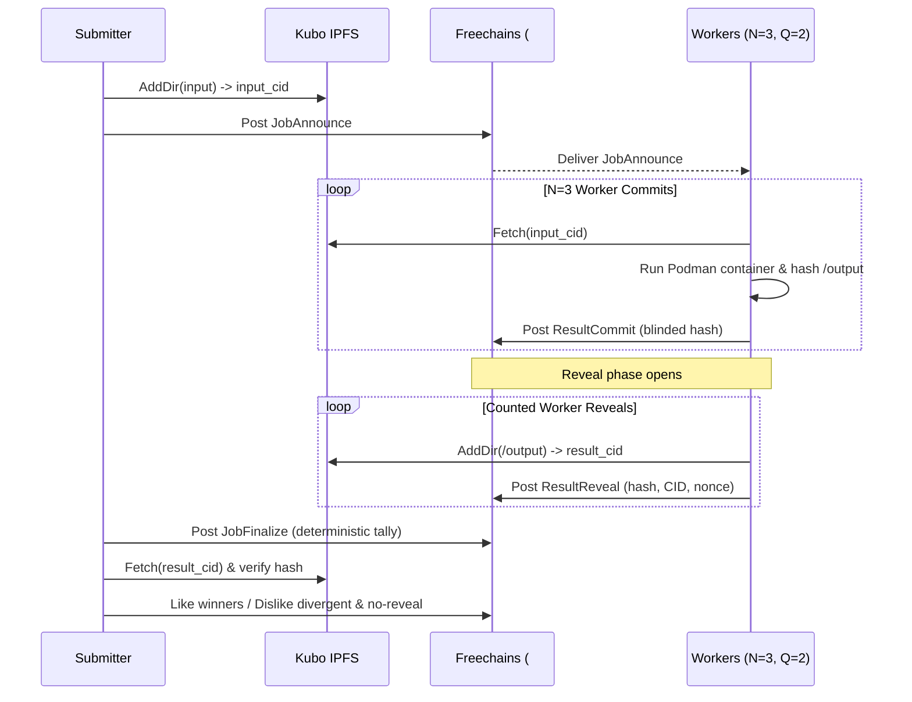

# Freecompute

Freecompute is an experimental, decentralized volunteer-computing platform in Go. It coordinates untrusted nodes to run deterministic container workloads over a peer-to-peer [Freechains](https://github.com/Freechains/freechains.vcs/tree/main) replication chain, Kubo IPFS storage, and rootless Podman sandboxes, using Ergo actor supervision and Protocol Buffers messages.

Freecompute is currently an MVP with an experimental `v0` public Go SDK (`pkg/freecompute`) whose API may evolve.

## How It Works, in Brief

A Submitter packages input files into Kubo IPFS and announces a job with replication factor $N$ and quorum $Q$ on a Freechains chain. Distinct Workers execute the digest-pinned container inside an isolated rootless Podman sandbox and publish cryptographic commits hiding their output hashes. Once $N$ commits arrive or the commit window closes with at least $Q$ commits, counted Workers upload outputs to IPFS and reveal their hashes and nonces. A deterministic finalization message records the tally; the Submitter fetches the winning result from IPFS and transfers reputation points (`like`/`dislike`) to workers. See [Protocol Specification](docs/protocol.md) for full details.



## Requirements

| Tool | Minimum Version | Purpose |
| :--- | :--- | :--- |
| Linux | Kernel with user namespaces | Rootless container isolation |
| Go | `>= 1.22` | Building binaries and running tests |
| [Freechains](https://github.com/Freechains/freechains.vcs/tree/main) | `0.20` | P2P DAG consensus, signing, and reputation |
| Kubo (IPFS) | `0.20+` | Content-addressed storage for inputs and outputs |
| Podman | `5.x` | Rootless container sandbox execution |
| OpenSSH | `ssh-keygen` | Generating Ed25519 node keypairs |
| System tools | `curl`, `flock`, `lua5.4`, `git` | Scripts and Freechains runtime |

Start prerequisites:


```bash
# 1. Start Kubo IPFS daemon
ipfs init 2>/dev/null || true && ipfs daemon &

# 2. Start rootless Podman socket
systemctl --user start podman.socket # or: podman system service --time=0 &

# 3. Pull image and export digest-pinned reference
podman pull docker.io/library/alpine:3.20
export VC_IMAGE="$(podman image inspect docker.io/library/alpine:3.20 --format '{{index .RepoDigests 0}}')"
```

## Quick Start

Clone the repository and run the automated 3-node end-to-end demonstration:
```bash
make demo
```

Expected final lines of `make demo`:
```text
==> Submitter Report & Verdict:
JOB_ID=4b80fbeb9e64c37ee6b5dd15ad3fecad763d757156e3f9a3a7759061c4cb3f15
ACCEPTED_HASH=d3beb797b44ba88fdceea6cef75d697cfc0b8285dc682f706c42efbcaa756622
VERIFIED=true
RESULT=11
WINNERS=ssh-ed25519 AAAAC3NzaC1lZDI1NTE5AAAAIAvst2Fv4K8tQdHy9+m7spR8ShSDKoahXpjKm7w+Jm2N,ssh-ed25519 AAAAC3NzaC1lZDI1NTE5AAAAIM8x7T10x3NbrZy5yQi1wU/qafGlLoodglrOBpRpaBrb,ssh-ed25519 AAAAC3NzaC1lZDI1NTE5AAAAIMIIe8SeHNCZvtNApRgp5iQESk30emhfDqCUx9HAvOMs
DIVERGENT=
NO_REVEAL=
    WINNERS_ALIASES=bob,alice,carol
    DIVERGENT_ALIASES=

==> Reputation (after):
    alice: 14166 (before: 16666)
    bob:   17066 (before: 16666)
    carol: 17566 (before: 16666)

PASS
```

To test fault injection and quorum rejection, run `make demo-divergent`. See [End-to-End Demo Guide](docs/demo.md) for full traces and explanations.

## Using the SDK

The `pkg/freecompute` SDK allows submitting, executing, and fetching workloads:

```go
package main

import (
	"context"
	"fmt"
	"os"
	"path/filepath"

	"github.com/VictorMilhomem/freecompute/pkg/freecompute"
)

func main() {
	ctx := context.Background()
	node, _ := freecompute.NewNode(freecompute.Config{
		ID: "alice", Root: "/tmp/alice/root", Key: "/tmp/keys/alice", Chain: "#vc",
	})
	_ = node.Start(ctx)
	defer node.Stop(context.Background())

	node.Serve(freecompute.WorkerPolicy{AllowImages: []string{os.Getenv("VC_IMAGE")}, AllowOwnJobs: true})

	job, _ := node.Submit(ctx, freecompute.JobSpec{
		Image:    os.Getenv("VC_IMAGE"),
		Cmd:      []string{"sh", "-c", "wc -w < /input/data.txt > /output/result.txt"},
		Input:    freecompute.FromBytes("data.txt", []byte("volunteer computing\n")),
		Replicas: 3, Quorum: 2, Reward: 1000,
	})

	res, _ := job.Wait(ctx)
	outDir, _ := os.MkdirTemp("", "vc-out-*")
	defer os.RemoveAll(outDir)
	_ = node.Fetch(ctx, res.OutputCID, outDir)
	data, _ := os.ReadFile(filepath.Join(outDir, "result.txt"))
	fmt.Printf("Job: %s Result: %s Winners: %v\n", res.JobID, string(data), res.Winners)
}
```

### Main Public Types

| Type | Kind | Role |
| :--- | :--- | :--- |
| `Config` | `struct` | Node paths, identity, Freechains chain, and peer network addresses |
| `Node` | `struct` | Freecompute instance created via `NewNode(cfg, opts...)` managing actors and daemons |
| `JobSpec` | `struct` | Specification defining container `Image`, `Cmd`, `Input`, `Replicas`, `Quorum`, and `Reward` |
| `Job` | `struct` | Submitted job handle providing `ID()`, `Events()`, `DroppedEvents()`, and `Wait(ctx)` |
| `Result` | `struct` | Outcome holding `AcceptedHash`, `OutputCID`, `Winners`, `Divergent`, and `NoReveal` |
| `WorkerPolicy` | `struct` | Execution filter setting `AllowImages`, `AllowAnyImage`, `AllowOwnJobs`, and `MaxConcurrent` |
| `Input` | `interface` | Off-chain data source built via `FromFile`, `FromDir`, `FromBytes`, or `FromCID` |

See [SDK Guide](docs/sdk.md) for patterns, events, sentinel errors, and options.

## Make Targets

| Target | Command | Description |
| :--- | :--- | :--- |
| `make all` | `make build build-example` | Builds production CLI (`bin/vcnode`) and SDK example (`bin/example-simple`) |
| `make build` | `go build ... ./cmd/vcnode` | Builds the production node binary `bin/vcnode` |
| `make build-example` | `go build ... ./examples/simple` | Builds the SDK example client `bin/example-simple` |
| `make build-faulty` | `go build -tags faulty ... ./cmd/vcnode-faulty` | Builds test fault-injection Worker `bin/vcnode-faulty` |
| `make test` | `go test ./...` | Runs unit and in-memory SDK integration tests |
| `make race` | `go test -race ./...` | Runs test suite with Go race detector |
| `make demo` | `./scripts/demo.sh` | Executes 3-node honest consensus demonstration |
| `make demo-divergent` | `./scripts/demo.sh --divergent` | Executes 3-node demonstration with a faulty worker |
| `make fmt` / `make vet` | `go fmt` / `go vet` | Code formatting and static analysis |
| `make clean` | `rm -rf bin` | Removes compiled binaries |

## Troubleshooting

| Symptom | Cause | Remedy |
| :--- | :--- | :--- |
| `IPFS daemon unreachable` | Local Kubo daemon is stopped or on another port | Run `ipfs daemon` or set `VC_IPFS_API=http://127.0.0.1:<port>` |
| `MISSING Podman socket` | Rootless Podman socket service inactive | Run `systemctl --user start podman.socket` or `podman system service --time=0 &` |
| `missing @sha256: digest` | Image reference uses a tag instead of digest hash | Inspect digest: `podman image inspect  --format '{{index .RepoDigests 0}}'` |
| `Permission denied` in `/output` or under SELinux | Mode not `0777` or missing container SELinux label | Ensure directory is `0777`; relabel with `chcon -Rt container_file_t <dir>` if needed |
| `insufficient reputation` | Submitter reps below `Reward * Replicas + 2 * PostCost` | Reduce reward/replicas, wait for causal confirmation, or transfer pioneer reps |
| Peers not syncing or chain IDs mismatch | Nodes initialized independently or missing `--hub` | Clone from primary (`chains add #vc clone <host:port>`) and pass `--hub` to daemons |
| Job stays in `Committing` or `Revealing` | Fewer than `Quorum` workers accept the job or image | Check worker logs; verify image allowlists and ensure `--allow-own-jobs` is set if needed |
| Leftover containers after abrupt process kill | Container cleanup routine did not run on `SIGKILL` | Start `vcnode` (which cleans orphans automatically) or run `podman rm -f --filter label=vc.managed=true` |

See [Troubleshooting Guide](docs/troubleshooting.md) for complete diagnostic steps.

## Limits and Roadmap

Freecompute is an MVP with known operational limits:
- **Collusion**: Quorum $Q$ requires matching outputs, but open-race commit slots do not prevent $Q$ colluding workers from publishing fabricated hashes without executing containers.
- **Confidentiality**: All job inputs, outputs, commands, and chain DAG messages are public on IPFS and Freechains.
- **Determinism**: Workloads must be strictly deterministic; non-deterministic outputs (timestamps, random IDs) fail quorum and incur penalties.
- **Escrow**: Reputation voting is executed by the Submitter upon finalization rather than on-chain smart contracts.

### Roadmap

- [x] Deterministic commit-reveal protocol with chain position windows and heartbeat ticks.
- [x] Crash-recovery persistence (`--state-dir`) saving worker nonces and output hashes.
- [x] Rootless Podman sandbox runner with cgroup limits and symlink traversal checks.
- [x] Public `v0` Go SDK (`pkg/freecompute`), CLI (`cmd/vcnode`), and demo suite.
- [ ] Schema-driven resource limits (`JobAnnounce.limits`) passed into container specs.
- [ ] Message batching to minimize Freechains post deposits across concurrent jobs.
- [ ] Pseudorandom worker assignment to mitigate commit race conditions.
- [ ] Optional input and output encryption for private workloads over IPFS.

## Documentation Index, Contributing, and License

### Documentation Index

- [Protocol Specification](docs/protocol.md): Deterministic state machine, message schemas, windows, and economics.
- [SDK Guide](docs/sdk.md): Public Go SDK API reference, patterns, error handling, and example binary.
- [Reference Manual](docs/reference.md): CLI flags, environment variables, configuration structs, sandbox model, and actors.
- [Security and Trust Model](docs/security.md): Threat vectors, mitigations, and operational boundaries.
- [End-to-End Demo Guide](docs/demo.md): Detailed walkthrough of `scripts/demo.sh` and output analysis.
- [Troubleshooting Guide](docs/troubleshooting.md): Exhaustive error index and resolution matrix.
- [Freechains Assumptions](docs/assumptions.md): CLI compatibility expectations and parser test guides.

### Contributing

Run formatting, static checks, unit tests, and race detection before opening a pull request:
```bash
make fmt vet test race
```

### License

License to be defined (see repository status).
